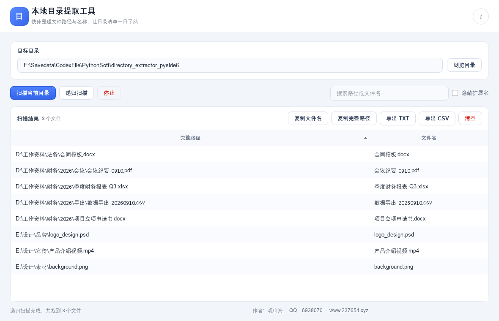
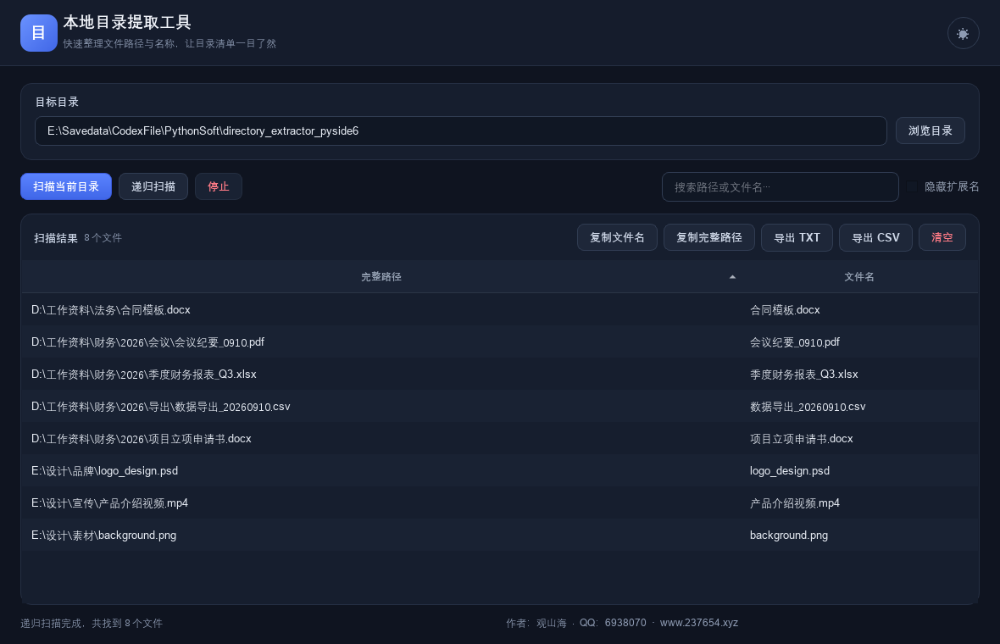

# 本地目录提取工具（PySide6）

[](LICENSE)
[](https://github.com/Guanshanhai/DirectoryExtractor/actions/workflows/build.yml)
[](https://github.com/Guanshanhai/DirectoryExtractor/releases)

一款用 PySide6 编写的本地目录清单提取工具：快速扫描目录、整理文件路径与文件名，并支持复制、导出为 Excel 可直接打开的 TXT/CSV。界面采用现代化单表格布局，避免左右列表选择或滚动不同步。

## 功能

- 扫描当前目录或递归扫描所有子目录
- 后台扫描，界面不会因大量文件而冻结，可随时停止
- 按路径或文件名即时搜索
- 多选结果；未选择时默认操作当前筛选后的全部结果
- 隐藏文件扩展名、复制文件名、复制完整路径
- 导出 UTF-8 BOM 编码的 TXT/CSV，Excel 可直接打开中文
- 双击文件可在系统文件管理器中定位
- 支持拖放文件夹、深浅色主题、记忆窗口大小和上次目录
- **自动更新检查**：启动时后台检测 GitHub 最新 Release，发现新版本弹窗提示并一键前往下载

## 安装与启动

### 方式一：下载便携 EXE（推荐普通用户）

前往 [Releases](https://github.com/Guanshanhai/DirectoryExtractor/releases) 下载最新的 `本地目录提取工具.exe`，双击即可运行，无需安装 Python。

### 方式二：从源码运行（开发者）

需要 Python 3.10 或更高版本：

```powershell
cd directory_extractor_pyside6
python -m pip install -r requirements.txt
python app.py
```

也可以直接双击 `启动程序.bat`，首次运行会自动安装 PySide6。

## 打包为 EXE（可选，开发者）

```powershell
python -m pip install pyinstaller
pyinstaller --noconfirm --windowed --onefile --name "本地目录提取工具" --icon zm_icon.ico app.py
```

如果没有 `zm_icon.ico`，删除命令里的 `--icon zm_icon.ico` 即可。程序本身也能在没有图标文件时正常运行。
也可以直接使用仓库内的 `app.spec`：`pyinstaller --noconfirm app.spec`。

## 自动更新说明

程序通过 GitHub 官方 API（`/repos/{仓库}/releases/latest`）检查更新：

- 启动时延迟 3 秒在后台静默检查一次，且按本地记录限频（至少间隔 1 天），不会频繁刷接口；
- 发现新版本会弹窗展示版本号与更新日志，点击「前往下载」打开 GitHub Release 页面，由用户手动下载替换；
- 也可随时点击标题栏的「检查更新」按钮手动检查；
- 网络异常、接口限流或无网络时均静默处理，不打扰使用。

> 开源发布后，请把 `app.py` 顶部的 `GITHUB_REPO` 常量改成你自己的 `"用户名/仓库名"`，否则更新检查会指向示例仓库。

## 开源协议

本项目以 [MIT 许可证](LICENSE) 开源。

## 界面预览

| 浅色 | 深色 |
| --- | --- |
|  |  |
